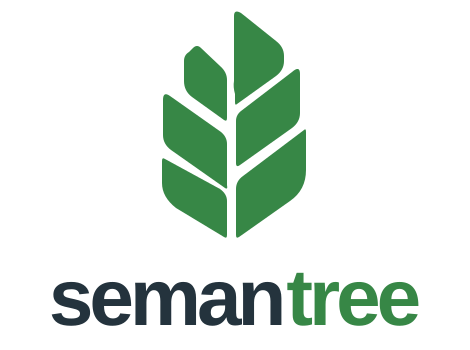
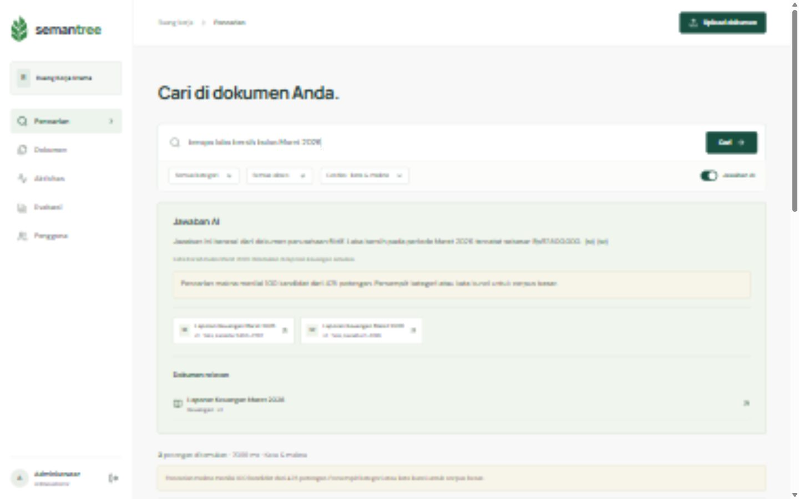

<p align="center"></p>

# Semantree

**AI-powered Document Knowledge & Semantic Search**, dengan jawaban AI dan sumber yang dapat ditelusuri.

Semantree adalah aplikasi open source untuk mengelola dokumen dalam ruang kerja, mencari informasi dengan kata kunci atau makna, lalu membaca jawaban AI beserta kutipan dan teks sumbernya. Pencarian, unggah, ekstraksi, kontrol akses, versi, dan integrasi model berjalan nyata, bukan hasil yang di-hardcode.

Repositori: [github.com/ramaikn/semantree](https://github.com/ramaikn/semantree). Lisensi: [MIT](LICENSE). Antarmuka dan dokumentasi utama menggunakan Bahasa Indonesia.

## Tampilan aplikasi



Screenshot aplikasi lokal menggunakan korpus perusahaan simulasi. Semantic search menggunakan reranking LLM, bukan embedding/vector index.

## Fitur

- **Dokumen:** unggah PDF berbasis teks, DOCX, TXT UTF-8, dan Markdown, maksimal 12 MB. Unduh file asli, baca hasil ekstraksi, dan telusuri versi aktif/arsip.
- **Pencarian:** filter kategori dan akses, pagination, highlight kuning, snippet di sekitar informasi relevan, tiga metode pencarian.
- **Makna:** reranking Gemini memahami parafrasa seperti `untung`/`laba`, `pemasok`/`supplier`, serta `bulan ketiga`/`Maret`.
- **Jawaban otomatis:** aktif secara default pada Cari/Enter, dapat dimatikan. Kutipan dan kartu dokumen relevan membuka potongan teks ekstraksi. Pagination tidak membuat jawaban ulang.
- **Akses:** akun administrator/anggota, ruang kerja terpisah, dokumen privat hanya untuk pemilik, dokumen bersama untuk anggota ruang kerja.
- **Versi dan indexing:** checksum, indeks versi aktif, unggah identik tanpa versi tambahan, kegagalan ekstraksi tidak merusak versi sebelumnya.
- **Evaluasi:** label relevansi manusia, pemisahan tuning/holdout, MRR, Recall@5, nDCG@5, latency, dan ekspor JSON.
- **Audit:** aktivitas indeks dan perubahan ruang kerja, penonaktifan akun mencabut sesi aktif.

## Cara pencarian bekerja

| Metode | Perilaku | Memakai AI |
|---|---|---|
| Semua kata | Full-text AND sebagai baseline | Tidak |
| Kata kunci + judul | Full-text OR dengan bobot judul | Tidak |
| Kata & makna | Kandidat berizin dinilai relevansinya oleh LLM | Ya |

Mode makna menggunakan **reranking LLM**, bukan embedding/vector index. Maksimal **100 kandidat** dinilai dan **40 matches** dikembalikan. Pada corpus demo 40 potongan, semua kandidat tercakup. Corpus besar dipangkas berdasarkan keyword dan UI memberi pemberitahuan batas cakupan. Jika model gagal, pencarian menampilkan fallback keyword secara eksplisit.

Asisten mencari sumber terlebih dahulu, memakai maksimal 16 potongan/24.000 karakter dan empat potongan per dokumen. Model tidak memiliki tool untuk melakukan tindakan. ID kutipan dan akses/versi divalidasi ulang. Jika bukti hanya sebagian tersedia, jawaban menjelaskan kekurangannya; jika tidak tersedia, asisten tidak boleh mengarang.

**Sakelar Jawaban AI hanya mengatur pembuatan jawaban.** Untuk tidak mengirim teks ke AI sama sekali, matikan sakelar dan pilih metode kata kunci. Gateway 9router lokal dapat meneruskan teks ke penyedia model eksternal.

## Stack

| Lapisan | Teknologi |
|---|---|
| Frontend | React 19, TypeScript, Vite, Lucide, Bun |
| API | Java 21, Spring Boot, JDBC, Maven |
| Data | PostgreSQL 17, full-text search, Flyway |
| Ekstraksi | Python dikelola uv, pypdf, python-docx |
| Model | API chat completions kompatibel OpenAI; default 9router + Gemini |

## Mulai cepat di Windows x64

Jalur setup dan pengujian yang diverifikasi adalah **Windows x64**. Instal [Bun](https://bun.sh) dan [uv](https://docs.astral.sh/uv/) terlebih dahulu. PowerShell, `tar`, koneksi internet, serta ruang untuk JDK/PostgreSQL diperlukan. Tidak membutuhkan npm, Docker, atau perubahan PATH sistem.

```powershell
git clone https://github.com/ramaikn/semantree.git
cd semantree
powershell -NoProfile -ExecutionPolicy Bypass -File scripts/setup.ps1
```

Setup mengunduh tools portabel yang belum ada ke `.tools`: JDK 21 (checksum SHA-256 dari Adoptium), Maven 3.9.11 (SHA-512), dan PostgreSQL 17.9 (HTTPS vendor; checksum independen belum tersedia dalam script). Lalu dependency Bun/uv dipasang dengan hardlink dan database lokal dijalankan. Tools ini tidak membutuhkan proyek lain.

`.env` dibuat lokal dengan password acak. Login menggunakan `BOOTSTRAP_EMAIL` dan `BOOTSTRAP_PASSWORD` dari file tersebut. Akun awal hanya dibuat saat database belum punya pengguna; mengedit `.env` bukan cara reset password akun yang sudah ada. Jangan commit `.env`.

### Konfigurasi AI

Isi `.env` yang dihasilkan setup:

```dotenv
APP_ORIGIN=http://127.0.0.1:5174
AI_BASE_URL=http://127.0.0.1:20128/v1
AI_MODEL=ag/gemini-3.8-flash-low
AI_API_KEY=<kunci-Anda-sendiri>
```

9router/model tidak disertakan dalam repositori. Jalankan gateway dan pastikan model tersedia. Base URL harus mengarah ke root API, misalnya `/v1`, bukan sudah termasuk `/chat/completions`. Tanpa key, keyword tetap berfungsi dan mode makna memberi notice fallback; jawaban AI melaporkan belum dikonfigurasi. Penyedia lain dengan API serupa dapat dikonfigurasi, tetapi yang diuji nyata adalah 9router dengan model default di atas.

### Jalankan aplikasi

Terminal pertama:

```powershell
powershell -NoProfile -ExecutionPolicy Bypass -File scripts/start-backend.ps1
```

Terminal kedua:

```powershell
powershell -NoProfile -ExecutionPolicy Bypass -File scripts/start-frontend.ps1
```

| Layanan | Alamat |
|---|---|
| Aplikasi | http://127.0.0.1:5174 |
| API / health | http://127.0.0.1:8081/api/health |
| PostgreSQL | 127.0.0.1:55433 |

Gunakan `127.0.0.1`, bukan `localhost`, kecuali APP_ORIGIN disesuaikan. Health mengembalikan `starting`/503 sampai bootstrap selesai, kemudian `ok`/200. Semua layanan bawaan bind loopback.

Pada restart, jalankan database lebih dulu:

```powershell
powershell -NoProfile -ExecutionPolicy Bypass -File scripts/start-database.ps1
```

Hentikan frontend/backend dengan Ctrl+C. Untuk menghentikan database:

```powershell
powershell -NoProfile -ExecutionPolicy Bypass -File scripts/stop-database.ps1
```

## Isi demo atau dokumen sendiri

Setelah backend aktif:

```powershell
bun run scripts/import-company.ts
```

Importer membuat **15 dokumen penuh perusahaan makanan fiktif PT Pangan Lestari Nusantara**: profil, katalog produk, laporan keuangan Januari/Februari/Maret 2026, arus kas/neraca, penjualan, supplier, pembelian, stok, produksi, mutu, pengiriman, pengaduan/penarikan, serta kredit/piutang. Angka berasal dari satu ledger dan dicek konsistensinya. Ini data simulasi, bukan perusahaan, laporan audit, sertifikasi pangan, atau nasihat pajak nyata.

File benar-benar diupload lewat API produk, diekstrak, dan diindeks. Manifest/checksum ditulis ke `.runtime`, tidak ikut Git. Impor ulang identik tidak membuat versi tambahan. Importer juga mengisi delapan label awal (dua tuning, enam holdout); pengulangan impor dapat menambah label duplikat, sehingga tinjau halaman Evaluasi bila mengimpor berulang. Importer hanya menghapus dokumen FastAPI lama yang dahulu diimpor otomatis oleh pemilik, bukan dokumen pribadi lain. [Detail corpus](docs/company-data.md).

Coba:

- `laporan keuangan maret 2026`
- `berapa untung bersih bulan ketiga tahun 2026`
- `siapa pemasok ikan untuk sambal dan berapa lama kirimnya`
- `barang yang tanggal habis pakainya paling dekat dikirim dulu`
- `Berapa laba bersih Maret 2026 dan siapa pemasok tuna untuk sambal?`
- `Berapa omzet April 2026?` untuk melihat informasi belum tersedia, bukan angka karangan.

Anda juga dapat login, pilih Upload dokumen, tentukan privat/ruang kerja, lalu Cari. Gunakan file yang memang boleh Anda unggah dan kirim ke penyedia AI. PDF scan belum mendukung OCR.

## Pengujian

Dengan database aplikasi aktif:

```powershell
powershell -NoProfile -ExecutionPolicy Bypass -File scripts/test.ps1
```

Script menjalankan test corpus/highlight Bun, unittest extractor melalui uv, build TypeScript/Vite, JUnit Java, serta HTTP nyata di **8082**, memakai database **`enterprise_search_test`** terpisah yang dibuat ulang. Database utama tidak direset. Hindari menjalankan test saat database test digunakan pekerjaan lain. Jika AI_API_KEY tersedia, integrasi AI memanggil penyedia nyata dan dapat mengonsumsi kuota.

Pemeriksaan corpus aktif dengan Gemini:

```powershell
bun run scripts/review-company.ts
```

Hasil verifikasi terakhir: 5 test corpus/highlight, 3 test ekstraksi, 6 JUnit, dan 12 kelompok API lulus; empat query makna serta tiga pertanyaan corpus perusahaan diuji nyata. UI diperiksa desktop/mobile. Ini **bukan** audit keamanan, benchmark enterprise, atau jaminan keakuratan model. [Bukti dan batas pengujian](docs/verification.md).

## Struktur proyek

```text
backend/       API, autentikasi, dokumen, retrieval, AI, evaluasi
database/      Skema dan migrasi PostgreSQL
pipeline/      Extractor serta pengujian Python
frontend/      Antarmuka React, logo SVG, sumber dan highlight
demo/          Ledger dan corpus perusahaan simulasi
scripts/       Setup Windows, layanan, importer, pengujian
docs/          Arsitektur, keamanan, data, hasil verifikasi
```

Kontrak endpoint dan invariant akses ada di [peta sistem](docs/architecture.md). [CONTRIBUTING](CONTRIBUTING.md) menjelaskan kontribusi; [SECURITY](SECURITY.md) menjelaskan pelaporan kerentanan. Logo di `frontend/public/semantree-mark.svg` dan `semantree.svg` digambar ulang dari referensi branding pemilik, tanpa latar putih; versi lengkap memakai teks SVG dengan fallback font sistem, sehingga bentuk huruf dapat sedikit berbeda antarplatform.

## Troubleshooting

| Masalah | Periksa |
|---|---|
| Login gagal saat startup | Tunggu health 200; gunakan credential `.env` saat akun pertama dibuat |
| Port sedang digunakan | Hentikan layanan Semantree sebelumnya; jangan menghentikan proses asing |
| Origin ditolak | Samakan URL browser dengan APP_ORIGIN; hindari campuran localhost/127.0.0.1 |
| AI tidak menjawab / fallback | Key, base URL, ketersediaan model, kuota, log backend; tidak ada jawaban palsu pengganti |
| PDF tidak berisi teks | Upload PDF teks, DOCX/TXT/Markdown; scan membutuhkan OCR yang belum tersedia |
| Build Windows terkunci | Backend memakai salinan `.runtime/application.jar`, bukan JAR target build |
| uv offline test gagal | Jalankan setup/`uv sync --link-mode hardlink` lebih dulu untuk mengisi cache |

## Keamanan, privasi, dan batas

Cookie sesi HttpOnly/SameSite, BCrypt, Origin guard, batas login, workspace ACL, serta pemeriksaan ulang akses/versi sudah ada. Dokumen privat tidak terlihat bagi administrator lain. Namun Semantree belum production-ready untuk internet: belum HTTPS deployment, SSO/MFA, antivirus upload, konektor Drive/SharePoint, OCR, index vektor, audit keamanan eksternal, maupun pengujian beban.

Kutipan yang valid membuktikan referensi tersedia dan boleh diakses, **bukan** bahwa semua fakta yang disusun AI benar. Prompt injection tetap risiko residual. Pencarian makna serta jawaban mengirim teks ke provider; retention provider belum diaudit. Perpustakaan menampilkan maksimal 500 dokumen terbaru. [Keamanan detail](docs/security.md).

Kode dan aset proyek berlisensi [MIT](LICENSE). Dependency dan dokumen pihak ketiga tetap mengikuti lisensinya masing-masing. Importer FastAPI opsional memverifikasi MIT dan menyimpan atribusi; [riwayat sumber publik](docs/public-data.md). Semantree independen dan tidak berafiliasi dengan eBdesk atau penyedia AI. Pengembangan dibantu AI; review manusia tetap diperlukan sebelum memakai perubahan pada data penting.
